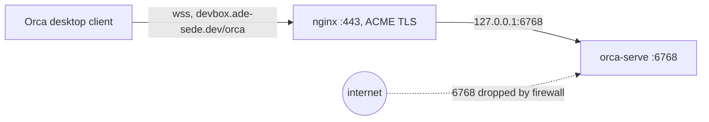

# Orca server

[Orca](https://onorca.dev) runs here as a Remote Orca Server: the box owns the full
runtime (worktrees, terminals, agent sessions), and desktop clients connect to it as
pure UIs. Agents keep running through client disconnects, laptop sleeps and server
reboots.

## How it is wired

- Package: `hosts/remote-devbox/orca-ide.nix`, built from the official
  [`.deb` release](https://github.com/stablyai/orca/releases) (the `.deb` never
  self-updates, so it plays well with the nix store; the AppImage does and is
  avoided).
- Service: `orca-serve`, a home-manager user unit defined in
  `hosts/remote-devbox/home-manager/orca.nix`. It runs
  `orca-ide serve --port 6768 --pairing-address https://devbox.ade-sede.dev/orca --supervise --no-pairing`,
  mirroring the unit Orca's own `orca serve service install` would write.
- Public endpoint: nginx (`hosts/remote-devbox/nixos/services.nix`) proxies
  `devbox.ade-sede.dev/orca` to `127.0.0.1:6768`, with ACME TLS and WebSocket
  support.
- Always online: `users.users.ade-sede.linger = true` in
  `hosts/remote-devbox/nixos/configuration.nix` starts the user manager (and the
  unit) at boot with no login session.



## Why the public endpoint instead of an SSH tunnel

Orca's Add Server flow classifies endpoint hostnames and refuses loopback ones
(`localhost`, `127.x`, `::1`), so a LocalForward tunnel can never be entered in
the GUI. The public domain classifies as `public` and is accepted.

Orca listens on `0.0.0.0:6768` (bind hardcoded upstream), but the firewall only
allows `22 80 443 3000`, so the port is reachable solely through nginx. Clients
authenticate with a per-client pairing token, revocable in Settings → Shared
Server Access.

The pairing token is the only gate on a public endpoint. Orca's docs recommend
keeping remote servers on a private network path (Tailscale and similar); this
setup knowingly deviates.

## Ports to forward when SSHing

`~/.ssh/config` is generated from `home-manager/common/programs/ssh-gpg.nix` and
already carries these for `ssh devbox`:

| Port | What it reaches |
| ---- | ----------------------------- |
| 8080 | dev server (existing) |
| 3000 | ttyd web terminal behind nginx |

## One-time pairing

Pairing happens without the service so the pairing URL (a credential) never
lands in the journal:

```bash
systemctl --user stop orca-serve
orca-ide serve --port 6768 --pairing-address https://devbox.ade-sede.dev/orca   # prints the pairing URL, Ctrl-C when done
systemctl --user start orca-serve
```

Then on the laptop, in Orca: Settings → Remote Orca Servers → Add Server →
paste the URL. Grants persist across restarts.

Agent subscriptions live on this box, not the laptop:

```bash
orca account add --agent claude   # and codex, etc.
orca account list
```

## Updates

- The orcad server runtime self-updates: `orca serve` parks a bundle in the
  user's home state and updates it there, so server updates never touch the
  store.
- The nix pin (`version` + `hash` in `hosts/remote-devbox/orca-ide.nix`) only
  controls the CLI/launcher. Bump both to update it; Orca ships near-daily on
  the stable channel.

## Docs

- Remote Orca Servers: <https://www.onorca.dev/docs/remote-servers>
- SSH worktrees (the other remote mode): <https://www.onorca.dev/docs/ssh>
- CLI reference: <https://www.onorca.dev/docs/cli/reference>
